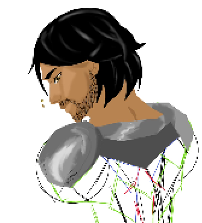
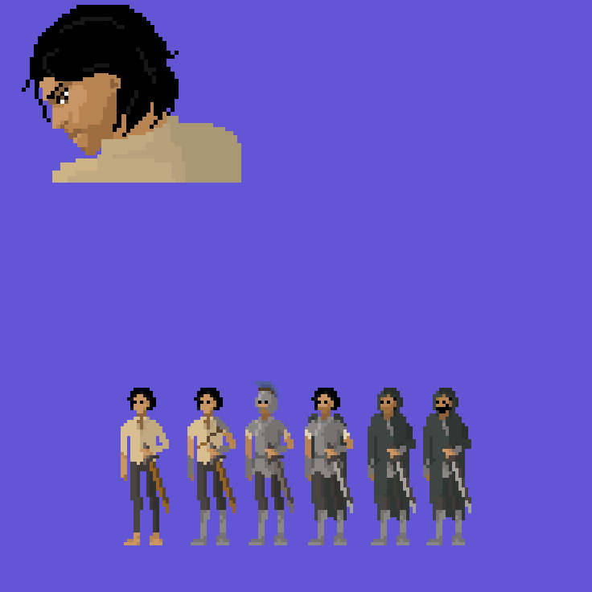
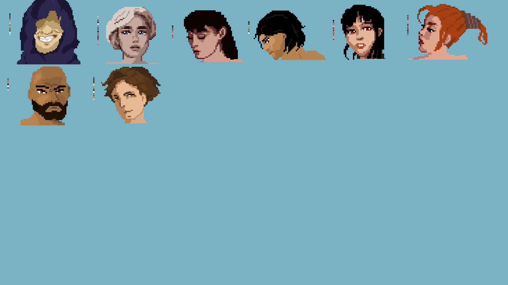

# Zoryel — dos fundamentos do PLN ao RAG semântico

> Um estudo prático de Processamento de Linguagem Natural (PLN): da preparação e representação clássica de textos à recuperação semântica com embeddings, FAISS e geração de respostas com um LLM.

<p align="center">
  
</p>

## Sobre o projeto

Este repositório reúne duas partes complementares para estudar PLN usando o universo narrativo de **Zoryel** como corpus de exemplo:

1. **PLN clássico:** tokenização, normalização, remoção de stopwords, Bag of Words (BoW) e TF-IDF, demonstrados em `PLN_principio.py`.
2. **PLN moderno aplicado:** um sistema local de perguntas e respostas no estilo **RAG (Retrieval-Augmented Generation)**, que recupera trechos da narrativa com embeddings e FAISS e usa um modelo de linguagem para formular a resposta.

A pergunta que conecta as duas demonstrações é:

> **“Quem é Zoryel?”**

A proposta é mostrar como uma pergunta em linguagem natural pode ser preparada e representada numericamente e, em uma arquitetura moderna, usada para localizar evidências em uma base textual e produzir uma resposta fundamentada nelas.

## Visão geral: uma evolução de representações

```text
                         PERGUNTA
                    "Quem é Zoryel?"
                            |
                            v
                 TOKENIZAÇÃO E NORMALIZAÇÃO
                  ["quem", "é", "zoryel"]
                            |
                            v
                       STOPWORDS
                         ["zoryel"]
                            |
               +------------+------------+
               |                         |
               v                         v
          BAG OF WORDS                 TF-IDF
       contagem de termos        pesos por relevância
               |                         |
               +------------+------------+
                            |
              REPRESENTAÇÕES CLÁSSICAS
               vetores esparsos (sparse)
                            |
               --- evolução conceitual ---
                            |
                            v
                       EMBEDDINGS
               vetores densos (dense)
                            |
                            v
                         FAISS
                 busca por similaridade
                            |
                            v
                   TRECHOS RECUPERADOS
                            |
                            v
                        PROMPT + LLM
                            |
                            v
                 RESPOSTA COM CONTEXTO
```

**Importante:** esse desenho é didático, não uma sequência literal executada pelo programa RAG. BoW e TF-IDF são alternativas clássicas de representação vetorial; não são etapas obrigatórias antes dos embeddings. Da mesma forma, o pipeline moderno não passa manualmente pela remoção de stopwords: o tokenizador do modelo de embeddings faz parte do próprio modelo.

## 1. Fundamentos clássicos do PLN

### 1.1 Tokenização

Tokenização é a divisão de um texto em unidades chamadas *tokens*. Dependendo do método, um token pode ser uma palavra, pontuação, subpalavra ou outro fragmento.

Exemplo ilustrativo de tokenização por palavras:

```text
Entrada:  Quem é Zoryel?
Tokens:   ["Quem", "é", "Zoryel", "?"]
```

Também podemos estudar sequências de tokens:

- **Unigrama:** `Quem`, `é`, `Zoryel`.
- **Bigrama:** `Quem é`, `é Zoryel`.
- **Trigrama:** `Quem é Zoryel`.

Essas sequências são chamadas de *n-gramas*. A tokenização não interpreta quem é Zoryel; apenas segmenta a entrada em unidades manipuláveis.

### 1.2 Normalização e stopwords

Antes da representação, é comum normalizar o texto: converter para minúsculas, retirar pontuação ou padronizar caracteres. Em seguida, algumas aplicações removem *stopwords* — palavras muito frequentes que podem ter pouca utilidade para uma tarefa específica, como artigos, preposições e algumas conjunções.

Exemplo didático:

```text
Original:       "Quem é Zoryel?"
Normalizado:    ["quem", "é", "zoryel"]
Após stopwords: ["zoryel"]
```

No script deste repositório, `PLN_principio.py`, além da lista de stopwords do NLTK, `quem` e `é` são adicionadas explicitamente à lista para ilustrar a transformação.

> **Atenção:** remover stopwords não é uma regra universal. Palavras como “não” podem inverter o sentido de uma frase; “quem” também carrega a intenção interrogativa do nosso exemplo. A remoção deve ser decidida de acordo com a tarefa. O resultado `zoryel` é uma simplificação didática, não uma recomendação para limpar todas as consultas de um sistema de perguntas e respostas.

### 1.3 Bag of Words (BoW)

O **Bag of Words** cria um vocabulário a partir de um corpus e representa cada documento pela contagem das palavras desse vocabulário. A ordem original das palavras não é preservada.

Considere um corpus reduzido, inspirado na narrativa:

| Documento | Conteúdo resumido |
|---|---|
| D1 | Zoryel é um jovem troiano dos arredores de Tróia. |
| D2 | Zoryel foi colocado sob o comando de Enéias. |
| D3 | Enéias era o guia e protetor das linhagens troianas. |
| D4 | Heitor era o Escudo do Povo; Paris, o Julgamento da Beleza. |
| D5 | Zoryel buscava equilíbrio e compreendia o motivo da luta. |

Um vocabulário ilustrativo seria: `zoryel`, `enéias`, `troiano`, `heitor` e `paris`. Considerando apenas esses termos, a pergunta após o pré-processamento (`zoryel`) pode ser representada como:

```text
[zoryel, enéias, troiano, heitor, paris]
[   1,      0,       0,      0,     0]
```

O valor `1` indica que o termo aparece uma vez na consulta; `0` indica ausência. Em uma matriz real, cada posição corresponde a um termo do vocabulário completo.

**Limitação:** BoW conta ocorrências, mas não entende significado, sinônimos ou contexto. A ordem das palavras é descartada.

### 1.4 TF-IDF

O **TF-IDF (Term Frequency–Inverse Document Frequency)** também produz vetores esparsos, mas pondera os termos conforme sua frequência no documento e sua raridade no corpus.

- **TF (Term Frequency):** mede a frequência do termo em um documento.
- **IDF (Inverse Document Frequency):** reduz o peso de termos que aparecem em muitos documentos e valoriza relativamente os mais discriminativos.

Uma forma simplificada de expressar a ideia é:

\[
TF\text{-}IDF(t,d)=TF(t,d)\times IDF(t)
\]

Uma forma comum de IDF suavizado é:

\[
IDF(t)=\ln\left(\frac{N+1}{df(t)+1}\right)+1
\]

Em que `N` é o total de documentos e `df(t)` é o número de documentos que contêm o termo `t`.

**Diferença essencial:** BoW conta; TF-IDF pondera. Ambos continuam baseados em correspondência de termos e não representam diretamente sinônimos ou significado contextual.

### 1.5 O que vem depois: embeddings

Word2Vec e GloVe são exemplos clássicos de técnicas que aprendem representações distribuídas de palavras. Modelos mais recentes, baseados em arquiteturas como Transformers, permitem produzir representações de frases e documentos que capturam relações semânticas mais complexas.

Por exemplo, as perguntas abaixo usam palavras diferentes, mas podem procurar a mesma informação:

```text
"Quem é Zoryel?"
"Quem é o protagonista da história?"
```

Uma busca baseada apenas na coincidência literal de palavras pode não relacioná-las. Um modelo de embeddings pode mapear as frases para vetores próximos quando o contexto aprendido indica significados relacionados.

Embeddings não são uma etapa que “contém” BoW ou TF-IDF. São outra família de representações, com propriedades e custos diferentes.

## 2. Demonstração clássica no código

O arquivo [`PLN_principio.py`](PLN_principio.py) implementa o exemplo didático com:

- `nltk.word_tokenize`: tokenização;
- `nltk.corpus.stopwords`: lista de stopwords em português, complementada por `quem` e `é`;
- `CountVectorizer`: matriz Bag of Words;
- `TfidfVectorizer`: matriz TF-IDF;
- produto entre matrizes esparsas para calcular similaridade entre a consulta e os documentos do pequeno corpus.

O corpus contém cinco frases inspiradas em Zoryel, Enéias, Tróia, Heitor e Paris. Ele é intencionalmente pequeno para facilitar a leitura das matrizes durante uma apresentação; não representa toda a base narrativa utilizada pelo RAG.

### Executar a demonstração

```bash
pip install nltk scikit-learn
python PLN_principio.py
```

Na primeira execução, o NLTK baixa os recursos `punkt_tab` e `stopwords`. Depois, eles ficam disponíveis no cache local do NLTK.

## 3. Aplicação moderna: RAG com Zoryel

O sistema RAG utiliza o arquivo [`Epilogo2.txt`](Epilogo2.txt) como fonte de conhecimento. Em vez de enviar todo o documento ao LLM a cada pergunta, o programa divide o texto em fragmentos, cria embeddings para esses fragmentos, indexa os vetores e recupera os mais relevantes para cada consulta.

### Componentes utilizados

| Componente | Responsabilidade no projeto |
|---|---|
| `BAAI/bge-m3` | Modelo de embeddings usado para representar os fragmentos e a pergunta. |
| `SentenceTransformer` | Carrega o modelo e gera os vetores com `encode()`. |
| `FAISS` | Indexa os vetores e pesquisa os fragmentos mais similares. |
| `IndexFlatIP` | Busca por produto interno; com vetores normalizados, equivale à similaridade de cosseno. |
| `Qwen/Qwen2.5-0.5B-Instruct` | LLM utilizado para gerar uma resposta a partir da pergunta e dos trechos recuperados. |

### Pipeline de indexação

1. **Carregamento:** `carregar_texto()` lê a narrativa de um arquivo `.txt`.
2. **Chunking:** `dividir_em_trechos()` agrupa linhas não vazias em fragmentos. Por padrão, usa janela de 8 linhas e passo de 5 linhas, resultando em sobreposição de 3 linhas entre fragmentos consecutivos.
3. **Embeddings:** `SentenceTransformer` codifica cada fragmento com `normalize_embeddings=True`.
4. **Indexação:** `faiss.IndexFlatIP` recebe os vetores normalizados.

### Pipeline de consulta

1. A pergunta digitada é codificada pelo mesmo modelo BGE-M3.
2. FAISS pesquisa os vetores mais próximos; por padrão, `K = 5`.
3. Os trechos recuperados são organizados como contexto.
4. O contexto e a pergunta são enviados ao Qwen por meio de um prompt de sistema.
5. O prompt instrui o modelo a responder em português usando somente os trechos fornecidos. Quando a melhor similaridade fica abaixo do limiar configurado, o código não chama o LLM.

Configurações padrão em `rag_local.py`:

```python
MODELO_EMB = "BAAI/bge-m3"
MODELO_LLM = "Qwen/Qwen2.5-0.5B-Instruct"
JANELA = 8
PASSO = 5
K = 5
LIMIAR = 0.30
```

O limiar `0.30` é uma configuração inicial do projeto, não um valor universal. Scores dependem do modelo, do conteúdo e da estratégia de segmentação; devem ser avaliados com exemplos reais.

## 4. Busca lexical × busca semântica

O arquivo [`rag_local_demo.py`](rag_local_demo.py) foi preparado para comparar duas ideias de recuperação:

- **Busca esparsa/lexical:** conta palavras exatas em comum entre pergunta e fragmento.
- **Busca densa/semântica:** codifica a pergunta e os fragmentos com BGE-M3 e pesquisa os vetores com FAISS.

A função `busca_esparsa_palavras()` é uma linha de base didática de sobreposição de palavras. Apesar do comentário no código mencionar TF-IDF/BM25 como referência de estilo, ela **não implementa TF-IDF nem BM25**. Para demonstrar esses algoritmos, use `PLN_principio.py` e seus vetorizadores do scikit-learn.

A comparação ajuda a mostrar que:

- a busca lexical é útil quando os termos da pergunta aparecem literalmente no documento;
- embeddings podem recuperar trechos relevantes mesmo quando a formulação da pergunta difere da formulação da narrativa;
- busca semântica também pode errar: similaridade não é garantia de que o trecho contém a resposta correta.

## 5. Interface web de demonstração

O arquivo [`rag_web.py`](rag_web.py) expõe uma interface local com chat, etapas de processamento, gráfico de similaridade dos fragmentos, ranking dos trechos recuperados e visualização do fragmento selecionado.

Essa interface é útil para uma apresentação ao vivo porque permite observar não apenas a resposta final, mas também parte do processo de recuperação.

## 6. Instalação e execução do RAG

Recomenda-se criar um ambiente virtual. Os comandos abaixo são exemplos para Python e podem variar de acordo com o sistema operacional e a instalação do PyTorch.

### Ambiente virtual

```bash
python -m venv .venv
```

Ativação no Windows (PowerShell):

```powershell
.venv\Scripts\Activate.ps1
```

Ativação no Linux/macOS:

```bash
source .venv/bin/activate
```

### Dependências do RAG local em CPU

```bash
pip install torch --index-url https://download.pytorch.org/whl/cpu
pip install sentence-transformers faiss-cpu transformers accelerate
```

A primeira execução baixa os modelos configurados (BGE-M3 e Qwen) e os mantém no cache do Hugging Face. O download exige conexão com a internet e espaço em disco; execuções seguintes podem reutilizar o cache local.

### Executar no terminal

```bash
python rag_local.py --arquivo Epilogo2.txt
```

Executar somente a recuperação, sem carregar o LLM:

```bash
python rag_local.py --arquivo Epilogo2.txt --so-busca
```

Ajustar fragmentação e quantidade de resultados:

```bash
python rag_local.py --arquivo Epilogo2.txt --janela 6 --passo 4 --k 5
```

### Executar a demonstração comparativa

```bash
python rag_local_demo.py --arquivo Epilogo2.txt
```

### Executar a interface web local

```bash
python rag_web.py --arquivo Epilogo2.txt
```

A interface é aberta em `http://localhost:8000` por padrão. Para alterar a porta, use `--porta`, por exemplo `--porta 8080`.

## 7. Conceitos que não devem ser confundidos

| Conceito | O que faz | O que não faz |
|---|---|---|
| Tokenização | Divide o texto em unidades processáveis. | Não determina o significado do texto. |
| Stopwords | Remove termos selecionados conforme a tarefa. | Não é uma limpeza obrigatória para todo modelo. |
| BoW | Conta termos de um vocabulário. | Não preserva ordem nem contexto semântico. |
| TF-IDF | Pondera os termos pela frequência local e no corpus. | Não reconhece sinônimos por conta própria. |
| Embeddings | Mapeia texto em vetores densos aprendidos. | Não é o mecanismo de busca nem o gerador de respostas. |
| Chunking | Divide documentos em fragmentos de recuperação. | Não é tokenização. |
| FAISS | Indexa e recupera vetores similares. | Não cria embeddings nem gera texto. |
| LLM | Gera texto a partir das instruções e do contexto recebido. | Não garante, sozinho, que a resposta esteja fiel à fonte. |
| RAG | Combina recuperação de contexto e geração. | Não elimina automaticamente erros ou alucinações. |

## 8. Limitações e pontos para discussão

- **Pré-processamento depende da tarefa:** remover uma palavra pode eliminar informação importante, especialmente negações, pronomes interrogativos e relações gramaticais.
- **BoW e TF-IDF são lexicais:** têm bom desempenho em tarefas de correspondência de termos, mas não resolvem sozinhos paráfrases e sinônimos.
- **Chunking influencia a recuperação:** fragmentos pequenos podem perder contexto; fragmentos grandes podem misturar assuntos. Janela, passo e sobreposição são parâmetros a avaliar.
- **Score de similaridade não é probabilidade:** um valor alto não significa que a resposta está correta. O limiar precisa ser calibrado para a base e o modelo.
- **RAG depende da qualidade da fonte:** informações ausentes, contraditórias ou pouco claras no texto podem levar a respostas incompletas ou incorretas.
- **A geração ainda pode falhar:** instruções para usar somente o contexto ajudam a limitar respostas sem evidência, mas não garantem ausência de alucinações.
- **Execução em CPU tem custo:** carregar modelos e indexar uma base pode consumir memória e tempo, principalmente na primeira execução.

## 9. Material visual do universo de Zoryel

As imagens abaixo contextualizam o corpus narrativo usado na demonstração. Elas são apoio visual do projeto; não fazem parte do mecanismo de tokenização, embedding ou recuperação.

### Evolução visual do protagonista

<p align="center">
  
</p>

### Retrato de Zoryel

<p align="center">
  
</p>

### Galeria de personagens

<p align="center">
  
</p>

## 10. Estrutura relevante do repositório

```text
Zoryel/
├── Epilogo.txt
├── Epilogo2.txt
├── PLN_principio.py
├── PossiveisAlinhamentos.txt
├── projetoJogo.txt
├── rag_local.py
├── rag_local_demo.py
├── rag_web.py
└── assets/
    ├── zoryel-sprite-evolution.svg
    ├── zoryel-character-portrait.svg
    └── character-gallery.svg
```

## 11. Roteiro sugerido para apresentação

1. Apresentar PLN e o problema: transformar linguagem humana em dados que um programa consiga processar.
2. Digitar “Quem é Zoryel?” e mostrar a tokenização.
3. Explicar normalização e stopwords, discutindo a perda potencial de informação.
4. Mostrar como BoW cria contagens e como TF-IDF atribui pesos.
5. Contrastar vetores esparsos com embeddings densos e introduzir a busca semântica.
6. Executar o RAG e exibir os trechos recuperados pelo FAISS antes da resposta do LLM.
7. Fazer uma pergunta cuja resposta não esteja na base para discutir limiar, evidências e limitações.

## Referências de estudo

- [Notebook — Introdução ao Processamento de Linguagem Natural (Flávio Mota)](https://github.com/flavio-mota/fundamentos-pln/blob/master/Introdu%C3%A7%C3%A3o_ao_Processamento_de_Linguagem_Natural.ipynb)
- [NLTK — documentação](https://www.nltk.org/)
- [Scikit-learn — CountVectorizer](https://scikit-learn.org/stable/modules/generated/sklearn.feature_extraction.text.CountVectorizer.html)
- [Scikit-learn — TfidfVectorizer](https://scikit-learn.org/stable/modules/generated/sklearn.feature_extraction.text.TfidfVectorizer.html)
- [Sentence Transformers — documentação](https://www.sbert.net/)
- [FAISS — repositório oficial](https://github.com/facebookresearch/faiss)
- [Hugging Face — Transformers](https://huggingface.co/docs/transformers/index)

---

## 12. Contribuições:

Grupo Amigos e Fortunados de Joaz Rodrigues: Cezar Vitor, Guilherme Gomes, Nicollas Henrique, Igor Gabriel, 
Robinho, Joaz Rodrigues, Rafael Ratão, Renan, Rodrigo Marques. 

**Ideia central:** o projeto conecta fundamentos clássicos do PLN a uma aplicação moderna de recuperação aumentada por geração. BoW e TF-IDF mostram como representar textos por frequências; embeddings permitem recuperar conteúdos por proximidade semântica; FAISS localiza os trechos; e o LLM formula uma resposta a partir do contexto recuperado.
